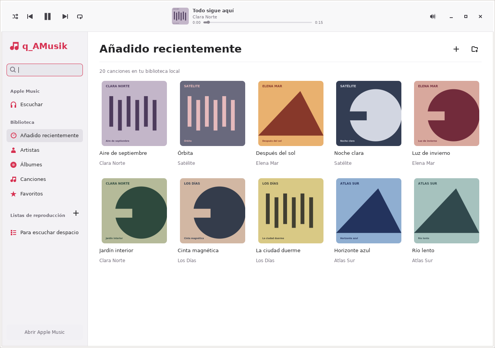
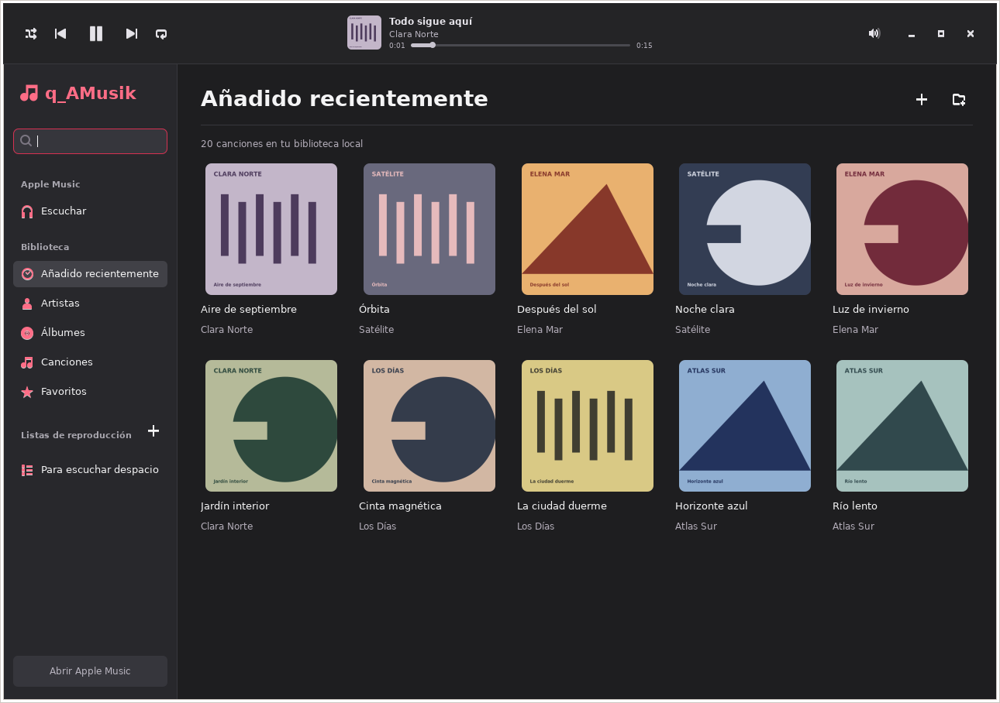

# q_AMusik · 0.2.0

Aplicación de escritorio **nativa para Linux**, inspirada en Apple Music.
Primera versión de desarrollo: reproductor local GTK/GStreamer y acceso al
reproductor oficial de Apple Music en el navegador. Proyecto independiente de Apple.

[](https://github.com/QRod/q_AMusik/actions/workflows/linux.yml)

[Descargar .deb](https://github.com/QRod/q_AMusik/releases/tag/v0.2.0) ·
[Instalación](docs/INSTALACION.md) · [Cambios](CHANGELOG.md) · [Licencia MIT](LICENSE)



*Captura de la prueba automatizada en Ubuntu: archivos WAV y carátulas geométricas de
demostración. No contiene música del catálogo ni datos de una cuenta real.*

<details>
<summary>Modo oscuro</summary>



</details>

## Instalación rápida

Descarga `q-amusik_0.2.0_all.deb` y `SHA256SUMS` desde la
[publicación v0.2.0](https://github.com/QRod/q_AMusik/releases/tag/v0.2.0).
En la carpeta donde guardaste ambos archivos:

```sh
sha256sum -c SHA256SUMS
sudo apt update
sudo apt install ./q-amusik_0.2.0_all.deb
q-amusik
```

Continúa si la suma muestra `OK`. La [guía de instalación](docs/INSTALACION.md)
incluye requisitos de Ubuntu/Zorin, descarga desde terminal, actualización,
respaldo y desinstalación.

## Estado real

| Función | Implementación |
|---|---|
| Biblioteca local | Importar archivos o carpetas recursivamente; sin copiar el audio |
| Formatos | MP3, FLAC, Ogg, Opus, M4A/AAC, WAV y AIFF, según códecs instalados |
| Metadatos | Título, artista, álbum y duración; nombre de archivo como alternativa |
| Organización | Búsqueda, favoritos y listas; cuadrículas de álbumes/artistas y tabla de canciones |
| Reproducción local | Pausa, anterior/siguiente, posición, volumen, aleatorio, repetición |
| Carátulas | Incrustadas en MP3/FLAC/M4A o imágenes cover/folder JPG y PNG de la carpeta |
| Apariencia | Claro y oscuro siguiendo las preferencias del escritorio |
| Persistencia | SQLite en el directorio de datos del usuario |
| Suscripción de Apple Music | Abrir `music.apple.com` en navegador; sesión y reproducción allí |
| Catálogo dentro de esta interfaz | Pendiente: MusicKit, credenciales de desarrollador y validación DRM |
| Paridad con la app de macOS | No alcanzada; consulta [ROADMAP.md](ROADMAP.md) |

Los controles locales no controlan Apple Music. Las listas y favoritos locales no
se sincronizan con tu cuenta. No se incluyen descargas offline del catálogo,
lossless del servicio, Dolby Atmos ni AirPlay. La extensión de un archivo no
garantiza que el códec esté disponible o que el contenido no tenga DRM.

## Ejecutar en Ubuntu / Zorin

Objetivos iniciales: Ubuntu 22.04/24.04 y Zorin basado en esas versiones.
La compatibilidad debe confirmarse en cada distribución con audio real.
No ejecutes la aplicación como root.

```sh
sudo apt update
sudo apt install python3-gi python3-gi-cairo python3-mutagen gir1.2-gtk-3.0 gir1.2-gstreamer-1.0 \
  gstreamer1.0-plugins-base gstreamer1.0-plugins-good gstreamer1.0-plugins-bad \
  gstreamer1.0-libav gstreamer1.0-pulseaudio xdg-utils
git clone https://github.com/QRod/q_AMusik.git
cd q_AMusik
/usr/bin/python3 -m q_amusik
```

Usa Python del sistema: un entorno virtual aislado no suele encontrar PyGObject
instalado mediante APT. No hay dependencias de pip ni Node para ejecutar la app.

1. Añade archivos o carpetas desde la cabecera.
2. Haz doble clic en una canción para iniciar la cola de la vista actual.
3. Selecciona varias filas con Ctrl/Mayús para favoritos o listas.
4. En «Escuchar suscripción», abre Apple Music e inicia sesión en el sitio oficial.

Durante una importación puedes buscar y reproducir. La edición de favoritos,
listas y referencias espera hasta que termine el escaneo para evitar bloqueos.

La apariencia sigue el tema GTK del escritorio y, cuando está disponible, la
preferencia clara/oscura de GNOME/Zorin. Las carátulas se leen de las etiquetas
del archivo o de `cover.jpg`, `cover.png`, `folder.jpg` y `folder.png` en su carpeta.
Cuando no hay imagen, se muestra un sustituto neutro; no se descarga arte externo.

Si hay Chrome/Chromium instalado, se solicita una ventana de aplicación del
navegador; de lo contrario se utiliza el navegador predeterminado. q_AMusik no
instala navegadores ni módulos DRM. Comprueba el permiso de contenido protegido
si el servicio no reproduce canciones completas. El acceso web depende de Apple,
del navegador, de la región y de tu suscripción; aún no se ha probado aquí con
una cuenta real. Cierra o pausa el navegador antes de volver a reproducir música
local para evitar dos fuentes simultáneas.

## Paquete .deb

En Linux con `dpkg-deb`:

```sh
python3 packaging/build-deb.py
sudo apt install ./dist/q-amusik_0.2.0_all.deb
q-amusik
```

El paquete instala sólo esta aplicación en `/usr/share/q-amusik`, su lanzador,
icono y entrada de menú. La arquitectura `all` corresponde al código Python;
los códecs y GTK son paquetes de la arquitectura del sistema. No incluye skills,
herramientas compartidas, credenciales ni datos locales. La construcción,
instalación y ejecución de GTK ya pasaron en Ubuntu 24.04 mediante GitHub Actions.
Consulta el [registro de validación](docs/validation.md) y los resultados de la matriz.

## Datos y privacidad

La base es `$XDG_DATA_HOME/q_amusik/library.db`, o
`~/.local/share/q_amusik/library.db`. Contiene rutas y etiquetas de tu música,
favoritos y listas. «Quitar» elimina referencias, conservando siempre el audio.
Respáldala con la aplicación cerrada. Desinstalar el paquete conserva estos datos.
Para eliminar la biblioteca, cierra la aplicación y elimina ese directorio desde
tu gestor de archivos. Las sesiones de Apple se gestionan desde el navegador.
No hay servidor, telemetría, subida de archivos ni almacenamiento de Apple ID.

## Desarrollo y verificación

```sh
python3 -m unittest discover -s tests -v
python3 -m compileall -q q_amusik packaging tests
# Sólo Linux, con xvfb, dbus-x11 e imagemagick:
dbus-run-session -- xvfb-run -a -s '-screen 0 1600x1200x24' /usr/bin/python3 tests/native-smoke.py
```

La prueba nativa genera audio WAV sintético, verifica GTK y reproducción con un
sumidero de prueba, comprueba las vistas y ambos temas, y guarda capturas en `validation/`. No comprueba el dispositivo
de audio físico, Apple ID, DRM ni una suscripción. El flujo de GitHub Actions
incluye Ubuntu 22.04/24.04; el badge enlaza a los resultados de ambas plataformas.

Arquitectura y decisiones: [docs/architecture.md](docs/architecture.md).

## Licencia

El código de q_AMusik se distribuye bajo la [licencia MIT](LICENSE).
Las dependencias conservan sus propias licencias. No se distribuye contenido
del catálogo de Apple ni se conceden derechos sobre sus marcas.

Referencias oficiales: [MusicKit](https://developer.apple.com/musickit/),
[autenticación](https://developer.apple.com/documentation/applemusicapi/user-authentication-for-musickit),
[Apple Music web](https://support.apple.com/en-euro/guide/music-web/apdm8de77edb/web).
